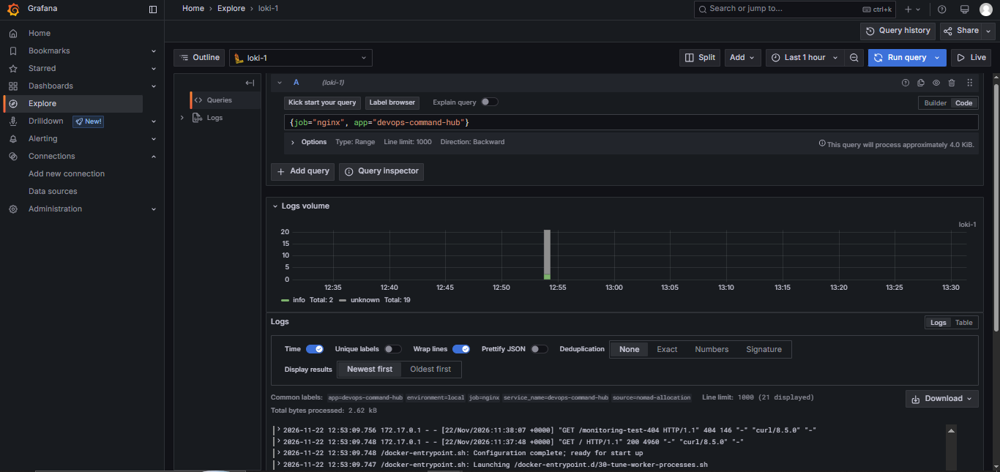
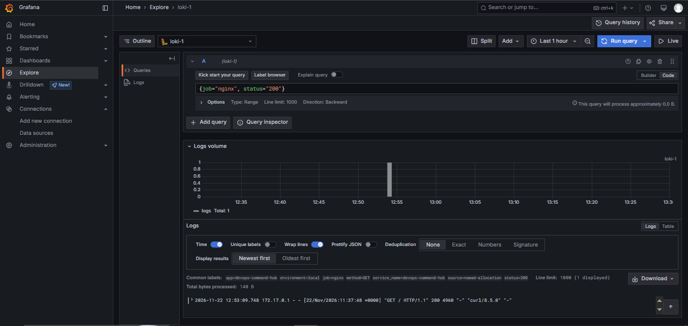
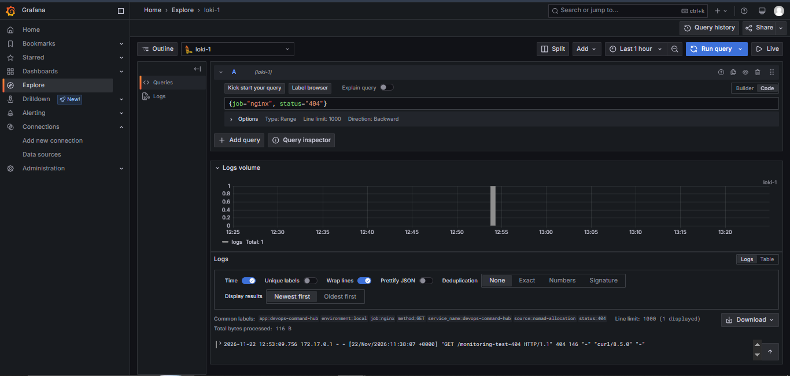

# DevOps Intern Final Assessment

**Author:** Isaac Ambi

**Project:** DevOps Command Hub

**Assessment date:** 22 November 2026


[](https://github.com/Tunecci/devops-intern-final/actions/workflows/ci.yml)

A containerised web application with automated CI/CD, Linux administration scripts, Nomad orchestration, Consul service discovery, and centralised log monitoring using Loki, Promtail and Grafana.

## 1. Project Overview

This project demonstrates an end-to-end DevOps workflow, from application development and automated validation to container publishing, application orchestration and log monitoring.

The application is **DevOps Command Hub**, a lightweight command-reference website packaged in a Docker container and deployed using HashiCorp Nomad.

### Key Features

- Dockerised static web application using a pinned NGINX Alpine base image.
- Non-root container execution.
- Custom NGINX configuration and `/healthz` health endpoint.
- Docker health checks and build SHA identification.
- Linux system information and application health-check scripts.
- GitHub Actions CI/CD pipeline.
- ShellCheck and Hadolint validation.
- Automated Docker image build and runtime testing.
- Container image publishing to GitHub Container Registry (GHCR).
- Nomad job deployment using the Docker driver.
- Consul service registration and HTTP health checks.
- Centralised log collection and visualisation using Promtail, Loki and Grafana.

## 2. Architecture

The following diagram illustrates the project's workflow and monitoring architecture.

```mermaid
flowchart TD
    A[Developer / Source Code] --> B[GitHub Repository]
    B --> C[GitHub Actions CI/CD]
    C --> D[ShellCheck and Hadolint]
    D --> E[Docker Build and Runtime Tests]
    E --> F[GitHub Container Registry]
    F --> G[HashiCorp Nomad]
    G --> H[Docker Driver]
    H --> I[NGINX Application]
    I --> J[Nomad Allocation Logs]
    J --> K[Promtail]
    K --> L[Loki]
    L --> M[Grafana Explore]
    G --> N[Consul Service Discovery]
    I --> O[/healthz Endpoint]
    O --> N
```

### Workflow

1. Application source code is maintained in GitHub.
2. GitHub Actions runs automated linting and validation.
3. Docker builds and tests the application image.
4. Successful builds on the main branch are published to GHCR.
5. Nomad deploys the published container image.
6. Consul registers the application and monitors its HTTP health.
7. Nomad allocation logs are collected by Promtail.
8. Loki stores and indexes the logs.
9. Grafana provides an interface for querying and visualising application activity.

## 3. Technology Stack

| Technology | Purpose |
|---|---|
| Ubuntu 24.04 / WSL 2 | Local Linux environment |
| Git and GitHub | Version control and collaboration |
| GitHub Actions | CI/CD automation |
| Docker | Application containerisation |
| NGINX 1.27.5 | Web server |
| ShellCheck | Shell script analysis |
| Hadolint | Dockerfile linting |
| GHCR | Container image registry |
| HashiCorp Nomad 2.1.1 | Container orchestration |
| HashiCorp Consul 2.1.0 | Service discovery and health checks |
| Grafana Loki 3.5.0 | Log aggregation |
| Grafana Promtail 3.5.0 | Log collection and forwarding |
| Grafana 11.6.0 | Log visualisation |

Versions above reflect the environment and application images used during implementation.

## 4. Repository Structure

```text
devops-intern-final/
│
├── .github/
│   └── workflows/
│       └── ci.yml
│
├── app/
│   ├── Dockerfile
│   ├── nginx.conf
│   ├── index.html
│   ├── cheet.css
│   ├── cheet.js
│   ├── commands.js
│   └── LICENSE
│
├── scripts/
│   ├── sysinfo.sh
│   └── healthcheck.sh
│
├── nomad/
│   └── nginx-app.nomad.hcl
│
├── monitoring/
│   ├── docker-compose.yaml
│   ├── loki-config.yaml
│   ├── promtail-config.yaml
│   ├── loki_setup.md
│   └── logs/
│
├── docs/
│   └── screenshots/
│       ├── grafana-explore-all-logs.png
│       ├── grafana-http-200.png
│       └── grafana-http-404.png
│
├── .gitignore
└── README.md
```

The `app/LICENSE` file retains the MIT licence and attribution for the starter application assets.

## 5. Prerequisites

The following tools were used during implementation:

- Git
- Docker Engine with Docker Compose
- Ubuntu 24.04 or a compatible Linux environment
- Bash
- curl
- HashiCorp Nomad
- HashiCorp Consul

The monitoring and orchestration environment was tested using Docker Desktop with WSL 2 integration.

## 6. Quick Start: Run the Application

Clone the repository:

```bash
git clone https://github.com/Tunecci/devops-intern-final.git
cd devops-intern-final
```

Build the application image:

```bash
docker build \
  --build-arg BUILD_SHA="$(git rev-parse --short HEAD)" \
  -t devops-command-hub:local ./app
```

Run the container:

```bash
docker run -d \
  --name devops-command-hub \
  -p 8080:8080 \
  devops-command-hub:local
```

Verify the health endpoint:

```bash
curl -i http://localhost:8080/healthz
```

Expected response:

```text
HTTP/1.1 200 OK

healthy
```

Open the application:

```text
http://localhost:8080
```

To stop and remove the test container:

```bash
docker rm -f devops-command-hub
```

## 7. Application Containerisation

The application uses the pinned base image:

```dockerfile
FROM nginx:1.27.5-alpine3.21-slim
```

### Security and configuration

The Docker implementation includes:

- Non-root execution using UID/GID 101.
- NGINX configured to listen on port 8080.
- A custom `/healthz` endpoint.
- Temporary and runtime directories configured under `/tmp`.
- Docker `HEALTHCHECK`.
- Build SHA supplied through a Docker build argument.
- Response security headers.
- Reduced image size using the Alpine slim base image.

### Build verification

The completed image was approximately **19.6 MB**, below the assessment's 60 MB limit.

The application was tested with:

- HTTP 200 from `/healthz`.
- Successful homepage response.
- Non-root container execution.
- Docker health status showing healthy.

## 8. Linux Administration Scripts

### System Information Script

Location:

```text
scripts/sysinfo.sh
```

The script displays:

- Current username and user IDs.
- Hostname and kernel version.
- Current date and time.
- Disk usage.
- Memory usage.
- Docker installation and daemon status.

Run:

```bash
bash scripts/sysinfo.sh
```

### Application Health Check Script

Location:

```text
scripts/healthcheck.sh
```

The script checks an application URL using curl, evaluates its HTTP response, and provides diagnostic output when the check fails.

Run:

```bash
bash scripts/healthcheck.sh http://localhost:8080/healthz
```

A successful response produces:

```text
PASS: Server returned HTTP 200.
Health check successful.
```

Test an alternative URL by supplying it as the script argument.

Both scripts use Bash strict mode and include error handling.

## 9. CI/CD Pipeline

The workflow is located at:

```text
.github/workflows/ci.yml
```

It is configured to run on pushes and pull requests targeting the main branch.

### Pipeline stages

**1. Static analysis**

- ShellCheck validates shell scripts.
- Hadolint validates the Dockerfile.

**2. Build**

- Builds the Docker image.
- Supplies the Git commit SHA as the build identifier.

**3. Test**

- Starts the built container.
- Checks application availability and health.

**4. Publish**

- Publishes the container image to GHCR after successful validation and testing.
- Publishing runs on the main branch.
- Uses GitHub Actions permissions for package publishing.

### Published image

```text
ghcr.io/tunecci/devops-command-hub:latest
```

Pull the published image:

```bash
docker pull ghcr.io/tunecci/devops-command-hub:latest
```

The GitHub Actions workflow can be viewed here:

https://github.com/Tunecci/devops-intern-final/actions

## 10. Nomad and Consul Deployment

The Nomad job specification is located at:

```text
nomad/nginx-app.nomad.hcl
```

### Deployment configuration

The job deploys one NGINX application allocation through the Docker driver.

Resource settings:

| Resource | Configuration |
|---|---|
| CPU | 100 MHz |
| Memory | 64 MB |
| Task count | 1 |
| Container port | 8080 |
| Host port | Dynamically allocated |
| Health endpoint | `/healthz` |
| Health interval | 10 seconds |
| Health timeout | 2 seconds |

The deployment also includes:

- Consul service registration.
- HTTP health checking.
- Rolling update settings.
- Automatic rollback configuration.

### Start the development agents

Consul and Nomad were tested in development mode in separate Ubuntu terminals.

Consul:

```bash
consul agent -dev -client=0.0.0.0 -bind=<WSL_IP>
```

Replace `<WSL_IP>` with the current Ubuntu WSL network address.

Nomad:

```bash
sudo nomad agent -dev -bind=0.0.0.0 -network-interface=eth0
```

### Validate and deploy the job

```bash
nomad job validate nomad/nginx-app.nomad.hcl
```

```bash
nomad job run nomad/nginx-app.nomad.hcl
```

Check deployment status:

```bash
nomad status nginx-app
```

Inspect the allocation:

```bash
nomad alloc status <ALLOCATION_ID>
```

### Verification results

The deployed application was observed with:

- One desired allocation.
- One successfully placed allocation.
- One healthy allocation.
- Zero unhealthy allocations.
- Docker task running without restarts.

Consul registered the `nginx-app` service and reported its `nginx-http-health` check as **passing**.

The observed HTTP check returned:

```text
HTTP GET /healthz: 200 OK
Output: healthy
```

A successful application health request was also verified against the dynamically allocated Nomad port.

**Note:** Nomad dynamically allocates the host port. Obtain the current address and port from `nomad alloc status` rather than assuming they remain unchanged after redeployment.

## 11. Monitoring: Loki, Promtail and Grafana

Monitoring configuration is maintained in:

```text
monitoring/
```

The stack uses Docker Compose to run:

| Service | Container | Port |
|---|---|---|
| Loki | devops-loki | 3100 |
| Promtail | devops-promtail | 9080 |
| Grafana | devops-grafana | 3000 |

### Start the monitoring stack

From the project root:

```bash
docker compose -f monitoring/docker-compose.yaml up -d
```

Check the containers:

```bash
docker compose -f monitoring/docker-compose.yaml ps
```

Check Loki readiness:

```bash
curl -sS http://localhost:3100/ready
```

Expected output:

```text
ready
```

### Log collection

The NGINX application logs are obtained from the Nomad allocation log stream.

In this WSL/Docker Desktop environment, the allocation log stream is written to:

```text
monitoring/logs/nginx-nomad.log
```

Promtail reads the shared log file and forwards entries to Loki.

The configuration extracts HTTP methods and response status codes and attaches useful labels.

Labels include:

- `job`
- `app`
- `environment`
- `source`
- `method`
- `status`

### Grafana configuration

Open:

```text
http://localhost:3000
```

Configure a Loki data source with this URL:

```text
http://loki:3100
```

The connection was tested successfully.

### LogQL verification

General application logs:

```logql
{job="nginx", app="devops-command-hub"}
```

Successful HTTP requests:

```logql
{job="nginx", status="200"}
```

HTTP 404 responses:

```logql
{job="nginx", status="404"}
```

### Actual test results

The following requests were made against the Nomad-managed application:

```bash
curl -s -o /dev/null -w 'Homepage: HTTP %{http_code}\n' \
  http://<NOMAD_ADDRESS>:<DYNAMIC_PORT>/

curl -s -o /dev/null -w 'Missing page: HTTP %{http_code}\n' \
  http://<NOMAD_ADDRESS>:<DYNAMIC_PORT>/monitoring-test-404
```

Observed results:

```text
Homepage: HTTP 200
Missing page: HTTP 404
```

Both events were successfully collected by Promtail, stored in Loki and displayed in Grafana Explore.

### Monitoring documentation

For detailed deployment instructions, configuration explanations, queries and troubleshooting, see:

```text
monitoring/loki_setup.md
```

## 12. Screenshots and Evidence

The following screenshots document the monitoring implementation.

### Grafana Explore: Application Logs



### Successful HTTP Request: 200



### Intentional Missing Page: 404



These screenshots demonstrate successful log ingestion and filtering through Grafana Explore.

## 13. Troubleshooting and Lessons Learned

The implementation involved practical debugging across Docker, NGINX, Nomad, WSL and the monitoring stack.

### Issue 1: NGINX configuration contained a UTF-8 BOM

**Problem:** NGINX reported an unknown directive when starting the container.

**Cause:** The configuration file contained a UTF-8 byte-order mark.

**Resolution:** Recreated the configuration file using UTF-8 without a BOM and validated the NGINX configuration.

### Issue 2: Non-root NGINX process could not write to its cache directory

**Problem:** Running the container as UID 101 resulted in permission errors involving the NGINX cache/temp directories.

**Resolution:** Configured the runtime PID and temporary paths under `/tmp`, created the required directories and assigned ownership to UID/GID 101.

### Issue 3: Initial Docker image exceeded the 60 MB limit

**Problem:** The initial NGINX Alpine image exceeded the assessment's required image-size threshold.

**Resolution:** Switched to the pinned `nginx:1.27.5-alpine3.21-slim` base image. The resulting application image was approximately 19.6 MB.

### Issue 4: Docker Desktop container log files were inaccessible from Ubuntu WSL

**Problem:** The Docker log path returned by container inspection was inside Docker Desktop's internal Linux filesystem and was not directly accessible from the Ubuntu environment.

**Resolution:** Used `nomad alloc logs -f` to stream the Nomad allocation logs into a shared project directory. Promtail then collected the log file.

### Issue 5: Loki ingester was not immediately ready

**Problem:** Loki initially reported that its ingester was waiting for the 15-second readiness period.

**Resolution:** Allowed the initialisation period to complete and confirmed readiness using the Loki `/ready` endpoint.

### Issue 6: Grafana returned an unsupported protocol scheme error

**Problem:** Grafana could not execute a Loki query because the data source URL was not correctly configured.

**Resolution:** Set the Loki server URL to `http://loki:3100`, saved the configuration and verified the connection.

These issues helped validate the importance of container permissions, image optimisation, service readiness, networking and log collection.

## 14. Known Limitations

- The Nomad and Consul agents run in development mode; this is not a production cluster.
- The local Loki deployment has authentication disabled.
- Loki is configured with a 24-hour retention period.
- Promtail collects logs through the Nomad allocation log stream rather than directly mounting Docker's internal JSON log files.
- The log collector follows a specific allocation ID. When Nomad replaces the allocation, the collector must be restarted using the new allocation ID.
- The deployment is intended for local assessment and demonstration rather than high availability or production-scale workloads.

## 15. Conclusion

This project demonstrates a practical DevOps workflow covering application containerisation, Linux scripting, automated CI/CD, container registry publishing, orchestration, service discovery, health checks and centralised monitoring.

The application was successfully built and tested, published to GHCR, deployed through Nomad, registered with Consul and monitored using Promtail, Loki and Grafana.

Successful homepage requests and intentional HTTP 404 responses were verified through the monitoring pipeline.

The implementation provided practical experience in troubleshooting real deployment issues and documenting an end-to-end DevOps environment.

---

**Author:** Isaac Ambi

**GitHub:** https://github.com/Tunecci
